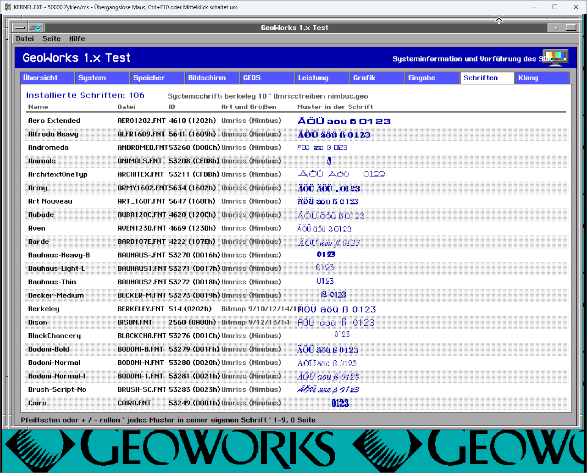

# GeoWorks 1.x Test

**Systeminformation und Vorführung des SDK** für das deutsche GeoWorks Ensemble 1.2
(Kernel 1.28) – geschrieben in 8086-Assembler (NASM) mit dem SDK
[pcgeos-1-sdk-v2](https://github.com/dnesbitt142/pcgeos-1-sdk-v2).

GeoWorks 1.x Test liest aus, auf welchem Rechner oder Emulator GeoWorks läuft
(DOSBox, Basebox, 86Box, QEMU …), zeigt alles auf zehn Seiten an, speichert,
kopiert und druckt den Bericht und führt dabei vor, was unter GeoWorks 1 mit
dem SDK möglich ist. Die FreeGEOS-Ausgabe ist
[freegeos-test](https://github.com/JMGeithain/freegeos-test).



## Installation

`dist/GWTEST.GEO` nach `GEOWORKS\WORLD` kopieren und GeoWorks neu starten.
Anleitung: [`dist/LIESMICH.TXT`](dist/LIESMICH.TXT).

## Seiten

| Taste | Seite | Inhalt |
|---|---|---|
| 1 | Übersicht | Rechner/Emulator, Prozessor, Speicher, Grafik, Versionen, Datum |
| 2 | System | CPU (auch CPUID), Koprozessor, BIOS-Kennung, Emulator, Schnittstellen, DOS |
| 3 | Speicher | INT 12h, CMOS, INT 15h, XMS, EMS, GEOS-Speicherverwaltung |
| 4 | Bildschirm | GEOS-Bildschirmtreiber, VESA-BIOS, Auflösung, Farbtiefe |
| 5 | GEOS | Version, KERNEL.EXE, Verzeichnis, Oberfläche, Geräte aus der GEOS.INI |
| 6 | Leistung | Geschwindigkeitsindex, Grafik, Speicher, Datei – mit Animation |
| 7 | Grafik | 16 Farben, RGB-Verläufe, Formen, Muster, Schriften, Bitmaps 1/4/24 Bit |
| 8 | Eingabe | Tastencodes, Maus, Malfläche (eigene Vis-Klasse mit Mausgriff) |
| 9 | Schriften | alle Schriftdateien in `FONT`: Name, Datei, ID, Art/Größen, Muster in der Schrift |
| 0 | Klang | Ton, Tonleiter, „Alle meine Entchen“, Akkord, vier Instrumente – PC-Lautsprecher |

Weitere Tasten: N/P blättern, Pfeile oder +/- rollen, M messen, S speichern,
K kopieren, H/? Hilfe, I Info, Esc Übersicht. Alle Anzeigen in Berkeley.

## Erkenntnisse über GeoWorks 1

- **Eigene Vis-Klasse mit Mausgriff** (wie im Kindermaler): siehe
  [SDK-VIS-KLASSE.md](SDK-VIS-KLASSE.md).
- **Schriften:** Programme haben kein `GrEnumFonts`. Die App liest mit
  `FileEnum` (Kernel 65) die `.FNT`-Dateien und deren Kopf: `"BSWF"`, Font-ID
  bei 8, Hersteller bei 0Ah (0 Bitmap, 1000h Nimbus, F000h Drucker), Name ab
  0Dh, Größen- und Umrisstabelle bei 21h–27h (Offsets + 6).
- **Klang:** Eine Sound-Bibliothek gibt es erst ab GEOS 2. Die App steuert
  den PC-Lautsprecher (Zeitgeber 2, Ports 42h/43h/61h) und `TimerSleep`
  (Kernel 184). Jede Note ist eine Nachricht an den eigenen Prozess mit
  `MF_FORCE_QUEUE` (4000h) – die App bleibt beim Spielen bedienbar.
- DOS über Kernel 95, Druckdialog (PrintControl), Zwischenablage, GEOS.INI.

## Bauen und testen

```
SDK=/pfad/zu/pcgeos-1-sdk-v2 ./build.sh        # -> out/GWTEST.GEO
SDK=/pfad/zu/pcgeos-1-sdk-v2 ./build.sh test   # + Emulatortest (Python, unicorn, pillow)
```

| Ordner | Inhalt |
|---|---|
| `app/` | Programm (NASM): `gwtest.nasm`, Erkennung, Bericht, Seiten, `fonts.inc`, `sound.inc` |
| `tools/` | Texte (`texts_de.txt`), Nachbearbeitung der GEO-Datei (Menüs, Druckobjekt, Vis-Klasse) |
| `icon/` | Programmsymbol GTS1ICON.PCX und Monikers |
| `test/` | Emulator mit Ersatz für Kernel- und UI-Aufrufe, 74 Prüfungen |
| `dist/` | fertige `GWTEST.GEO` |

Lizenz: MIT.
